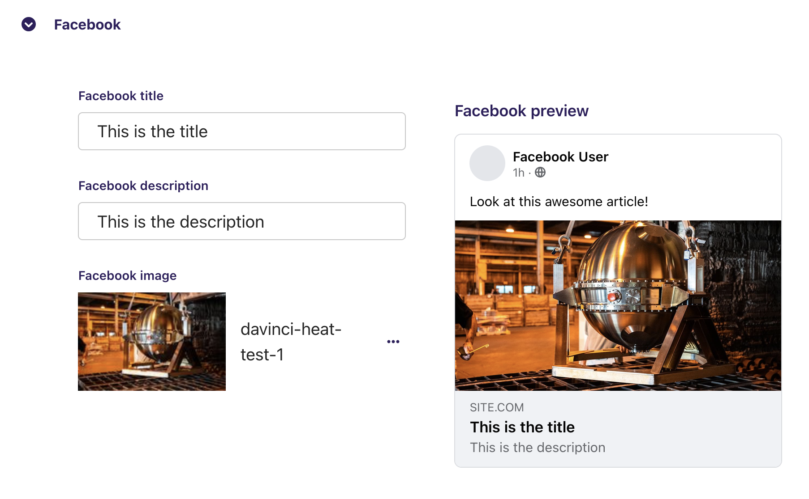

# wagtail meta preview

## Requirements

- Python 3.11, 3.12, 3.13, 3.14, 3.15
- Django 5.2, 6.0, 6.1
- Wagtail 7.4, 8.0, 8.1

Django 6.0 and 6.1 require Python 3.12 or newer, Wagtail 7.4 supports Django 5.2 and 6.0 only, and Python 3.15 requires Wagtail 8.1 and Django 6.1.3 or newer.

## Preview

Wagtail Meta Preview provides panels for previewing Facebook sharing, Twitter sharing and Google search results in the Wagtail admin.
Example of how the Facebook share looks like:

## Documentation

- [Getting started](./docs/1-getting-started.md)
- [Setting up panels](./docs/2-setting-up-panels.md)
- [Settings](./docs/3-settings.md)

## Translations

The preview panels follow the Wagtail admin language of the logged in user. Swedish is included.

To add a language:
- Add `-l <code>` to the `messages` target in the `Makefile`
- Run `make messages`
- Translate `wagtail_meta_preview/locale/<code>/LC_MESSAGES/django.po`
- Run `make messages` again and commit both the `.po` and `.mo` files

## Development

Requirements:
- Docker

Steps:
- Run `docker compose up`
- Open `http://localhost:8123/admin/` in your browser of choice
- Login using username "admin" and password "admin"

### Running tests

`make test`

See [CONTRIBUTING.md](./CONTRIBUTING.md) for code style, CI and how to release.

## License

Wagtail Meta Preview is released under the [MIT License](http://www.opensource.org/licenses/MIT).
